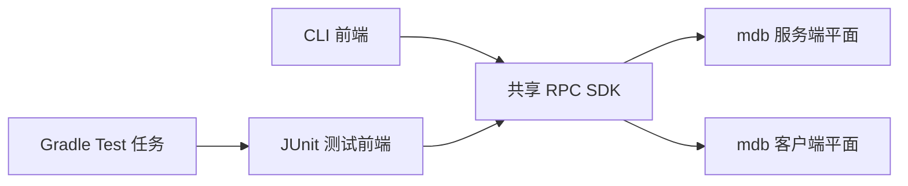

# mcdebug — Minecraft 调试工具

面向 Minecraft 模组开发的 JSON-RPC 调试工具。读取和修改服务端状态，
操作真实客户端界面，并将这些交互写成自动化测试。

单仓同时维护三个 Minecraft 版本：**26.3**（Fabric、NeoForge，JDK 25）、
**1.21.1**（Fabric、NeoForge，JDK 21）与 **1.20.1**（Forge，JDK 17）。
每个版本是 `versions/` 下的独立构建；CLI、SDK 与协议模块是纯 JVM 工程，支持 **Java 17+**。
结构与构建矩阵见[单仓多版本说明](docs/monorepo.md)。



CLI 用于交互调试和脚本；JUnit 测试前端由 Gradle 执行，两者共用同一份 RPC SDK。
服务端平面负责世界、库存和机器状态；客户端平面提供真实界面操作、截图及渲染诊断。
测试前端通过 [GitHub Maven 仓库](docs/testkit.md#github-maven-依赖)引入预编译依赖。
分发渠道只有两个：GitHub Release 提供五个模组 JAR 与 `mcdebug-cli.jar`，
`maven` 分支提供 `mcdebug-contract` / `mcdebug-sdk` / `mcdebug-testkit` 与各版本的预编译模组 JAR
（`mcdebug-mod-<mc>-<loader>`）；JitPack 发布链路已弃用。
`server.runCommand` 默认静默执行（反馈随 RPC 返回，`raw --show-chat` 恢复聊天提示）；
托管会话默认隐藏提示弹窗（`session start --show-toasts` 或 `gui toasts on|off` 切换）。

## 快速开始

```bash
(cd versions/mc26.3 && ./gradlew build)      # Fabric 26.3；:neoforge:build 产出 NeoForge 版
(cd versions/mc1.21.1 && JAVA_HOME=<JDK 21> ./gradlew build)
(cd versions/mc1.20.1 && JAVA_HOME=<JDK 17> ./gradlew build)   # 仅 Forge
./gradlew test                              # 纯 JVM 模块的编译与单测
./gradlew :cli:copyCliJar                   # CLI 内嵌上面已构建的模组 JAR
java -jar mcdebug-cli.jar jar --list        # 查看内嵌的 <mc, loader> 组合
java -jar mcdebug-cli.jar jar --mc 26.3 --loader fabric --output <gameDir>/mods
```

未构建的版本不会被 CLI 内嵌；`mcdebug jar` 会指出缺失组合的构建命令。
将匹配 Minecraft 版本与加载器的模组 JAR 安装到目标游戏环境，再连接游戏。
完整步骤见[安装与部署](docs/usage.md#安装与构建)。

## 文档

- [单仓多版本结构、构建矩阵与共享约定](docs/monorepo.md)
- [CLI、连接方式与端点发现](docs/usage.md#cli-使用方式)
- [托管客户端会话](docs/usage.md#托管会话linux-本机客户端)
- [界面自动化、截图与视觉断言](docs/usage.md#客户端平面gui)
- [JUnit / Gradle 客户端测试](docs/testkit.md)
- [原生可执行文件](docs/usage.md#原生可执行文件分发)
- [CLI 启动与 RPC 开销实测](docs/experiments/cli-startup-cost.md)
- [Minecraft 26.3 平台适配](docs/port-26.3.md)
- [技能：各 Minecraft 版本差异](skills/mcdebug/references/)
- [开发约定](AGENTS.md)

## 许可证

见 [LICENSE](LICENSE)。
