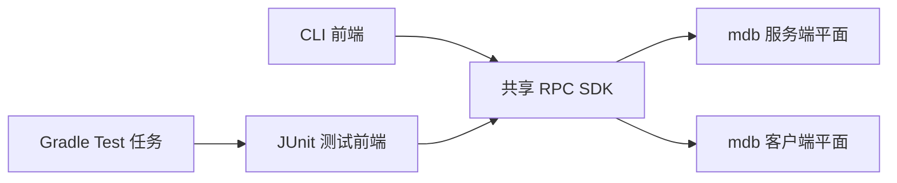

# mcdebug — Minecraft 调试工具

面向 Minecraft 模组开发的 JSON-RPC 调试工具。读取和修改服务端状态，
操作真实客户端界面，并将这些交互写成自动化测试。

本分支支持 **Minecraft 26.3**，提供 **Fabric** 和 **NeoForge** 后端。
构建项目、运行游戏需要 **JDK 25**；独立 CLI 支持 **Java 17+**。



CLI 用于交互调试和脚本；JUnit 测试前端由 Gradle 执行，两者共用同一份 RPC SDK。
服务端平面负责世界、库存和机器状态；客户端平面提供真实界面操作、截图及渲染诊断。
测试前端通过 [GitHub Maven 仓库](docs/testkit.md#github-maven-依赖)引入预编译依赖。

## 快速开始

```bash
./gradlew :cli:copyCliJar
java -jar mcdebug-cli.jar --help
```

将匹配版本的模组 JAR 安装到目标游戏环境，再连接游戏。
完整步骤见[安装与部署](docs/usage.md#安装与构建)。

## 文档

- [CLI、连接方式与端点发现](docs/usage.md#cli-使用方式)
- [托管客户端会话](docs/usage.md#托管会话linux-本机客户端)
- [界面自动化、截图与视觉断言](docs/usage.md#客户端平面gui)
- [JUnit / Gradle 客户端测试](docs/testkit.md)
- [原生可执行文件](docs/usage.md#原生可执行文件分发)
- [CLI 启动与 RPC 开销实测](docs/experiments/cli-startup-cost.md)
- [Minecraft 26.3 平台适配](docs/port-26.3.md)
- [开发约定](AGENTS.md)

## 许可证

见 [LICENSE](LICENSE)。
